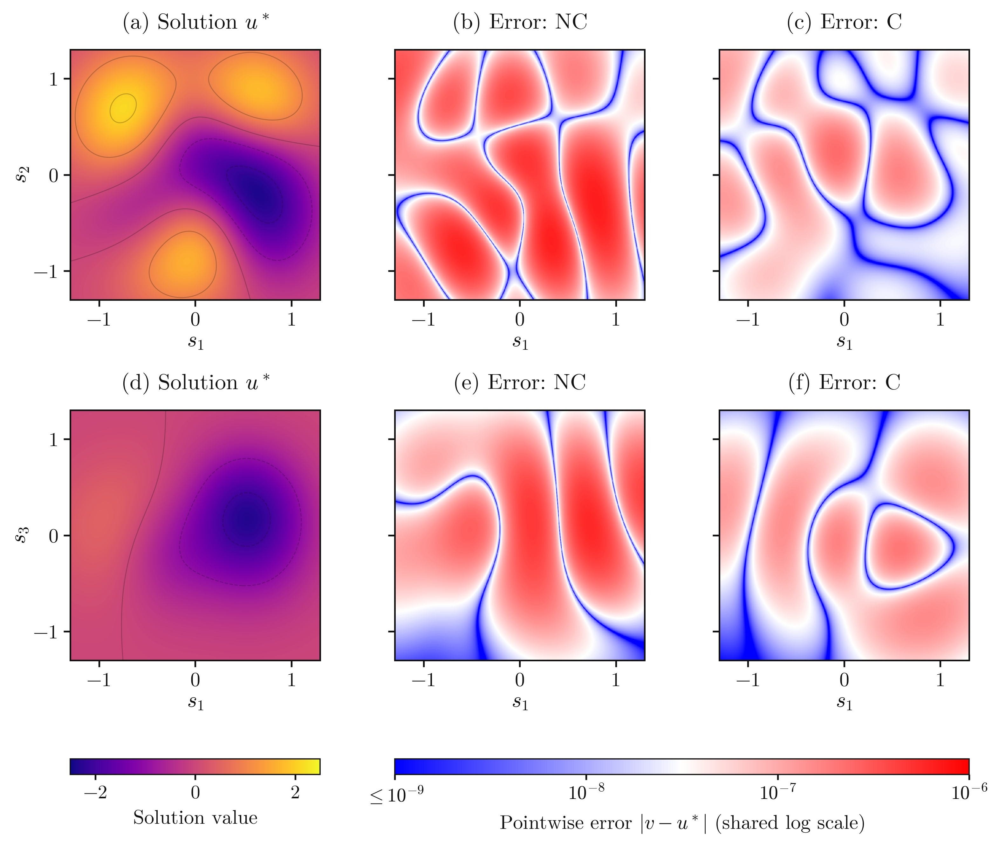
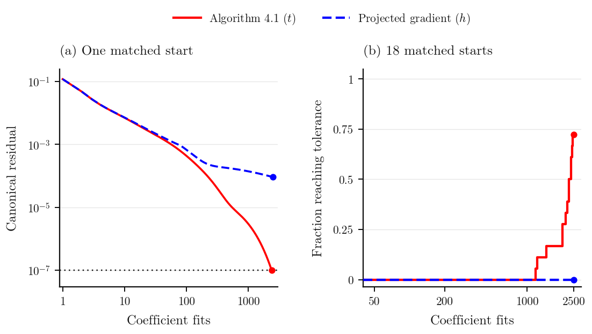
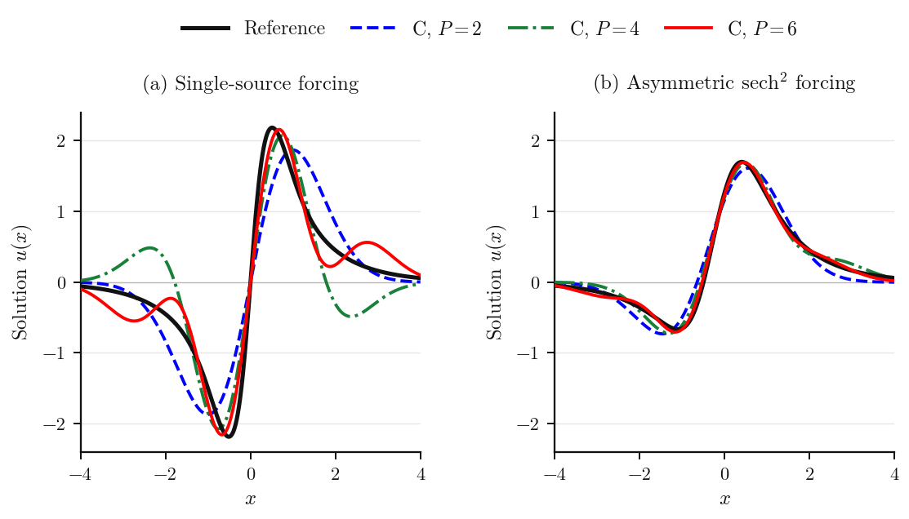

# Adaptive model completion for Gaussian approximation of elliptic PDEs

**Daniel Fernández and Enrique Zuazua** · Code, recorded experiments, and reproduction tools

This repository contains the experiments and figures reported in
*Adaptive model completion for Gaussian approximation of elliptic PDEs*,
including the studies described in its supplement, their controls,
unsuccessful runs, and numerical validation. Manuscript PDFs and LaTeX
sources are not distributed here. The [experiment index](experiments/README.md) connects each study
to its paper section, figures, tables, source code, and saved records.

The method represents colliding Gaussians in stable coordinates and allows
them to reach derivative limits. The experiments study solution recovery,
pair optimization, and prescribed-forcing problems for elliptic PDEs.

## Start here

| To… | Open… |
| --- | --- |
| Find an experiment from the paper | [Experiment index](experiments/README.md) |
| View the published plots | [Figure guide](figures/README.md) |
| Verify the downloaded files | `python3 reproduce.py check` |
| Rebuild figures or tables | [Reproduction guide](docs/REPRODUCING.md) |
| Inspect numerical implementations and records | [Reproduction workspace](reproduction/README.md) |
| Understand what was retained | [Repository scope](docs/SCOPE.md) |

## Three main illustrations

**Solution fields.** Target and matched NC/C errors on two slices of a
10-dimensional Poisson–Boltzmann problem. All panels use shared comparison
scales. [Figure 1, PDF](figures/figure_pb_solution_maps.pdf).



**Pair optimization.** Projected methods in the half-gap `h` and squared
half-gap `t = h²`, compared on the same 18 starts and canonical stopping
test. [Figure 2, PDF](figures/figure_alg41_cohort.pdf).



**Prescribed forcing.** Independent reference solutions and energy-selected
approximations with 2, 4, and 6 Gaussians.
[Figure 3, PDF](figures/figure_forcing_solutions.pdf).



## Quick start

```sh
git clone https://github.com/danielfdzm/adaptive-desingularization.git
cd adaptive-desingularization
python3 reproduce.py list
python3 reproduce.py check

python3 -m venv .venv
source .venv/bin/activate
python -m pip install -r requirements.txt
python reproduce.py figures
```

Listing and file verification use only Python's standard library. Figure
and table commands rebuild from saved records in a separate output
workspace. They do not train the models or replace the supplied records.
See the [reproduction guide](docs/REPRODUCING.md) for individual builders,
output locations, and fresh numerical runs.

## Methods in the records

| Name | Meaning |
| --- | --- |
| **S** | Ordinary Gaussians with coefficients refitted at each trial geometry |
| **NC** | Stable coordinates without completion |
| **C** | Experimental adaptive completion, including higher-order blocks |
| **C_d** | Discrete pair completion, retained as an ablation |
| **Algorithm 4.1** | The separately tested reversible projected pair method |

C and Algorithm 4.1 are distinct methods. A *fit* counts one coefficient
solve, including rejected trials; it is not a wall-clock measurement.
Controls and failures remain in the reported cohorts. The paper discusses
target-informed starts, limited geometric span, stopping sensitivity, and
the exploratory nature of the larger-budget forcing results.

## Layout

```text
experiments/     Paper-to-code index and machine-readable catalog
figures/         The 3 main and 11 supplementary publication figures
reproduction/    Selected source code, records, and file provenance
docs/            Reproduction instructions and scope decisions
reproduce.py     List, verify, and rebuild
SHA256SUMS       Integrity manifest for the supplied files
```

The internal workspace retains the relative paths used by the numerical
programs, so the saved source snapshots and their imports remain traceable.
This public repository starts with a clean experiments-only history.
Manuscript documents and earlier private repository history are excluded.

## Citation and license

Please cite *Adaptive model completion for Gaussian approximation of
elliptic PDEs* by Daniel Fernández and Enrique Zuazua. Machine-readable
metadata is in [CITATION.cff](CITATION.cff). The existing
[license](LICENSE) applies.
